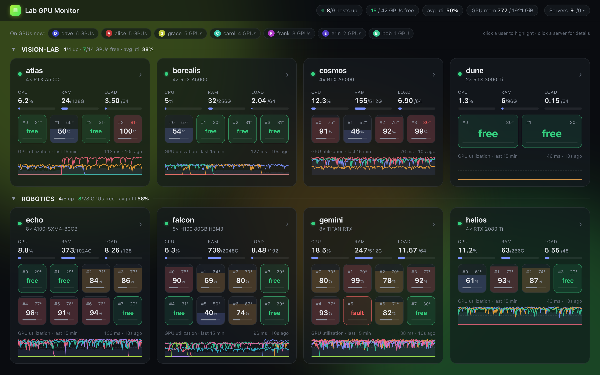
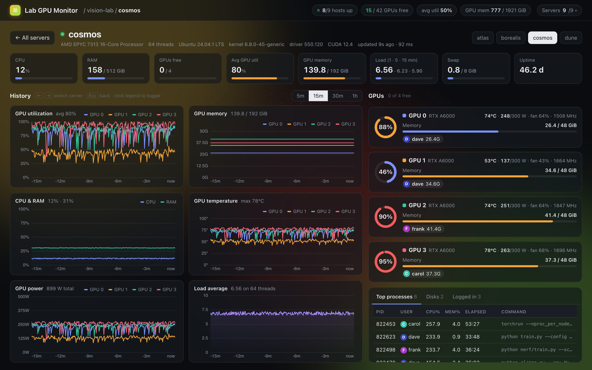
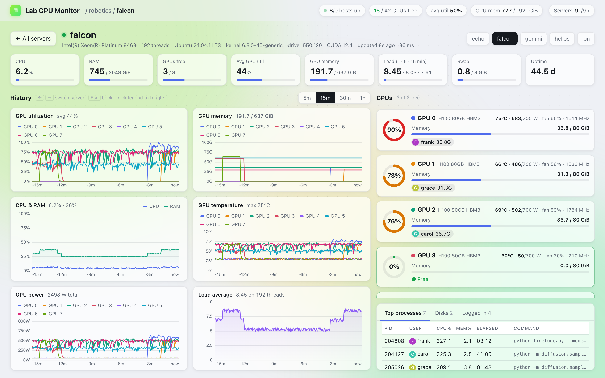

# Lab GPU Monitor

A small, dependency-free dashboard for watching GPU / CPU usage on shared lab servers over SSH.

- **Server** (`server.py`): Python 3 standard library only. Keeps one multiplexed SSH connection per host,
  polls `nvidia-smi`, `/proc` and `ps` every 3 s, and keeps 1 h of history in memory.
- **Page** (`index.html`): one file, no build step. Grouped overview, per-server detail page with
  interactive charts, server filter, user highlighting, faulty-GPU detection, light/dark mode, and a
  background whose color follows GPU load.

Nothing is installed on the servers. All you need is key-based SSH access and `nvidia-smi` there.



Click a server for its history charts, per-GPU details, processes, disks and logged-in users:



<details>
<summary>Light mode</summary>



</details>

*Screenshots use the built-in demo mode, so all servers, users and jobs are made up.*

## Try it without any servers

```bash
python3 server.py --demo
open http://127.0.0.1:8765
```

Demo mode makes up 9 servers with busy and idle GPUs, one offline server, one faulty GPU and an hour of
history. It doesn't use SSH or the network.

## Setup

### 1. Make sure you can SSH in without a password

Each server needs a `Host` entry in `~/.ssh/config`, and your public key in the server's
`~/.ssh/authorized_keys`:

```sshconfig
Host gpu-node1
    HostName 10.0.0.11
    User your-username
    Port 22
    IdentityFile ~/.ssh/id_ed25519
```

```bash
ssh-copy-id -i ~/.ssh/id_ed25519.pub gpu-node1     # asks for your password one last time
ssh -o BatchMode=yes gpu-node1 'nvidia-smi -L'     # should print GPUs with no password prompt
```

Optional: if some servers are only reachable through a gateway, add a second alias named `r<host>`
with a `ProxyJump`. When the direct connection fails, the dashboard switches to that alias automatically:

```sshconfig
Host rgpu-node1
    HostName 10.0.0.11
    User your-username
    ProxyJump gateway-host
```

### 2. Create your host list

Your real host list lives in `local/`, which is git-ignored, so server names never end up in the repo:

```bash
mkdir -p local
cp hosts.example.json local/hosts.json
```

Then edit `local/hosts.json`. Each key is a group name shown on the dashboard, and each value is a list
of `Host` names from your `~/.ssh/config`:

```json
{
  "lab-a": ["gpu-node1", "gpu-node2", "gpu-node3"],
  "lab-b": ["big-box1", "big-box2"]
}
```

### 3. Run

```bash
python3 server.py
open http://127.0.0.1:8765        # macOS; on Linux use xdg-open or just paste the URL
```

To try it without a config file, pass hosts directly: `python3 server.py gpu-node1 gpu-node2`.

The dashboard listens on `127.0.0.1` only, so it is not reachable from other machines. To open it from
your laptop while it runs on a server, either tunnel it:

```bash
ssh -N -L 8765:127.0.0.1:8765 my-server     # then open http://127.0.0.1:8765
```

or, if the server is on a private VPN, bind to that VPN address so anyone on the VPN can open it directly:

```bash
GPUMON_BIND=10.0.0.1 python3 server.py      # then open http://10.0.0.1:8765
```

There is no login, and the page shows every user's process command lines, so only bind to addresses
on networks you trust. Never use `0.0.0.0` on a machine with a public IP.

## Options

| Environment variable | Default             | Meaning                          |
|----------------------|---------------------|----------------------------------|
| `GPUMON_HOSTS`       | `local/hosts.json`  | path to the host list            |
| `GPUMON_PORT`        | `8765`              | web port                         |
| `GPUMON_BIND`        | `127.0.0.1`         | address to listen on (see below) |
| `GPUMON_INTERVAL`    | `3`                 | seconds between polls            |
| `GPUMON_HISTORY`     | `3600`              | seconds of history kept for charts |
| `GPUMON_CTL_DIR`     | `/tmp/gpumon-<uid>` | private folder for SSH connection-sharing sockets |

## Using the dashboard

- **Overview:** one card per server, grouped. Hover a GPU tile to see who is using it and the command.
  Click a user at the top to highlight their GPUs everywhere.
- **Servers ▾ (top right):** check or uncheck groups and servers to show. Your choice is remembered.
- **Click a server** for charts (GPU util / memory / temperature / power, CPU & RAM, load), per-GPU
  details, top processes, disks and logged-in users. Hover the charts for exact values, and click a
  legend entry to hide that series.
- **Keyboard:** on a server page, `←` / `→` switch servers and `Esc` goes back.
- A GPU shown as **fault** means `nvidia-smi` can't reach that card. It usually needs a reboot or an admin.
